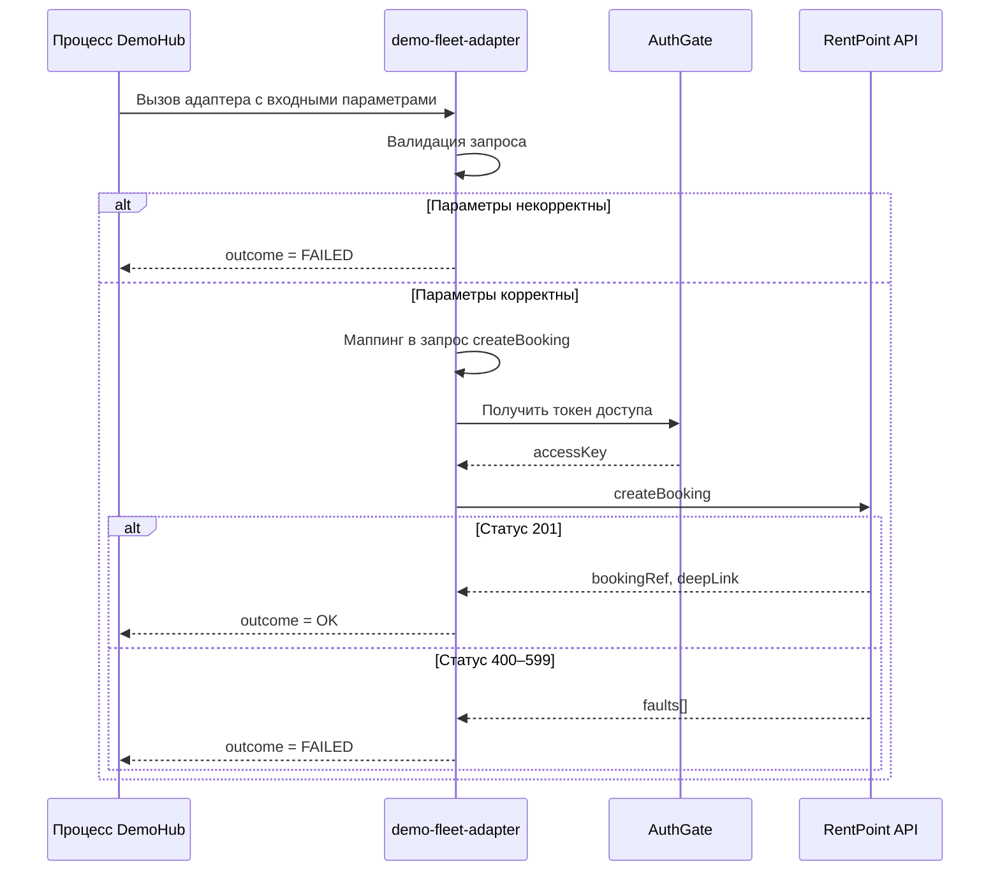

<!-- Space: DEMO -->
<!-- Parent: Спецификации -->
<!-- Title: [demo-fleet-adapter] Создать бронирование в RentPoint [7e21b9d04c5a] -->
<!-- Content-Appearance: full-width -->

<!-- Macro: :(STR|GUID):
     Template: ac:status
     Title: ${1}
     Color: Blue -->
<!-- Macro: :(DT):
     Template: ac:status
     Title: ${1}
     Color: Yellow -->
<!-- Macro: :(BOOL|LIST):
     Template: ac:status
     Title: ${1}
     Color: Red -->
<!-- Macro: :(DEC|INT):
     Template: ac:status
     Title: ${1}
     Color: Green -->
<!-- Macro: <details><summary>(.+?)</summary>
     Template: #expand_open
     title: ${1}
     expand_open: '<ac:structured-macro ac:name="expand"><ac:parameter ac:name="title">{{ .title }}</ac:parameter><ac:rich-text-body>'
     -->
<!-- Macro: </details>
     Template: #expand_close
     expand_close: '</ac:rich-text-body></ac:structured-macro>'
     -->

| Требование | Описание | Комментарий |
|---|---|---|
| **Назначение** | Создание бронирования автомобиля в системе RentPoint на основе данных мультизаказа из DemoHub | |
| **Тип** | `demo-fleet-rentpoint-adapter.booking-open` | |
| **Описание ошибок** | [Коды ошибок RentPoint](https://manual.rentpoint.test/fault-codes) | |

---

<!-- Include: ac:toc
     MinLevel: 2
     MaxLevel: 2 -->

## Алгоритм работы



**Алгоритм**

<table>
<tbody>
<tr>
<th>Предусловия</th>
<td>

К адаптеру обратился процесс-инициатор с входными параметрами.

</td>
</tr>
<tr>
<th>Сценарий</th>
<td>

**1. Инициализация и валидация входящего запроса**<br/>
Адаптер получает запрос с входными параметрами от процесса-инициатора.<br/>
a. если параметры переданы корректно — переход к следующему шагу основного сценария;<br/>
b. иначе — **альтернативный сценарий**

<details><summary>Некорректные параметры запроса</summary>

- Вернуть ответ инициатору запроса с параметрами:
  - outcome = FAILED
  - faultInfo:
    - runKey из окружения адаптера
    - flowName из окружения адаптера
    - note — сообщение об ошибке валидации
- Сценарий завершается

</details>

**2. Формирование запроса к RentPointAPI**

Адаптер выполняет **маппинг** полученных данных.

**3. Авторизация запроса через AuthGate**

Адаптер использует библиотеку demo-pass-kit для получения токена в AuthGate.

**4. Вызов сервиса RentPoint для создания бронирования**

Адаптер выполняет вызов [createBooking](https://manual.rentpoint.test/api/bookings-make) со сформированным телом запроса.

**5. Адаптер возвращает результат выполнения запроса инициатору**<br/>
Полученный в успешном ответе от RentPoint идентификатор бронирования (bookingRef) возвращается инициатору.

**Успешное завершение**: адаптер вернул **статус 201** и подготовленный ответ

```javascript collapse title Статус 201
{
    "outcome": "OK",
    "bookingRef": "RP-BKG-2026-004517",
    "deepLink": "https://rentpoint.test/bookings/RP-BKG-2026-004517"
}
```

**Неуспешное завершение**: адаптер вернул **статус 400–599**

<details><summary>Статус 400–599</summary>

- Вернуть ответ инициатору запроса с параметрами:
  - outcome = FAILED
  - faultText:
    - runKey из окружения адаптера
    - flowName из окружения адаптера
    - note — сообщение об ошибке от RentPoint
- Сценарий завершается

</details>

</td>
</tr>
<tr>
<th>Результат</th>
<td>

Адаптер вернул переменные в процесс или сообщение об ошибке.

</td>
</tr>
</tbody>
</table>

## Входные данные

| Параметр | Формат | Обяз | Описание | Пример |
|---|---|---|---|---|
| haltOnFailure | bool | Да | Признак остановки процесса в инциденте, если при работе адаптера получена ошибка. По умолчанию «да». | да |
| hubOrderKey | guid | Да | Идентификатор мультизаказа в DemoHub | 5b0e7a12-9c3d-4f8e-a1b2-6d4c3e2f1a00 |

**<u>customerInfo</u>**

| Параметр | Обяз | Формат | Описание | Пример |
|---|---|---|---|---|
| uid | Да | :GUID: | Идентификатор клиента | 0f9a8b7c-6d5e-4f3a-9b2c-1d0e9f8a7b6c |
| kind | Да | :STR: | Вид клиента — компания / частное лицо | CORPORATE<br/><br/>В createBooking передаём:<br/>CORPORATE — компания, мапим на CORP<br/>PRIVATE — частное лицо, мапим на PRV |
| registrationRef | Да | :STR: | Регистрационный номер компании | RN-2026-0042 |
| taxRef | Нет | :STR: | Налоговый код | TX-000-1187 |
| legalTitle | Нет | :STR: | Полное наименование компании | Общество «Северный ветер» |
| shortTitle | Нет | :STR: | Краткое наименование компании | Северный ветер |
| isVip | Нет | :BOOL: | Признак VIP-клиента | нет |
| industry.slug | Да | :STR: | Код отрасли | LOG-07 |
| industry.title | Нет | :STR: | Наименование отрасли | Логистика и доставка |
| foundedOn | Да | :DT: | Дата основания компании | 2014-03-21 |
| fleetSize | Нет | :DEC: | Количество автомобилей в собственном парке | 12 |
| sites[] | Нет | :LIST: | Адреса клиента | |
| sites[].kind | Да | :STR: | Вид адреса: REGISTERED / OFFICE | OFFICE |
| sites[].oneLine | Нет | :STR: | Полный адрес одной строкой | 10, Лесная ул., Зелёноград, 101000 |
| sites[].zip | Да | :STR: | Почтовый индекс | 101000 |
| sites[].town | Нет | :STR: | Город | Зелёноград |
| sites[].road | Нет | :STR: | Улица | Лесная |
| sites[].houseNo | Нет | :STR: | Номер дома | 10 |
| reach.tel | Да | :STR: | Телефон компании | +7 900 000-00-01 |
| reach.mail | Нет | :STR: | Почта компании | fleet@rentpoint.test |
| **keyPerson** | Нет | | Данные контактного лица | Блок данных о контактном лице |
| keyPerson.isDecisionMaker | Нет | :BOOL: | ~~Признак владельца компании~~<br/>**Признак лица, принимающего решение** | да |
| keyPerson.familyName | Нет | :STR: | Фамилия | Петров |
| keyPerson.givenName | Нет | :STR: | Имя | Пётр |
| keyPerson.patronymic | Нет | :STR: | Отчество | Петрович |
| keyPerson.cell | Нет | :STR: | Мобильный телефон | +7 900 000-00-02 |
| keyPerson.mail | Нет | :STR: | Почта | p.petrov@rentpoint.test |
| **keyPerson.license** | Нет | | Водительское удостоверение | |
| keyPerson.license.serial | Нет | :STR: | Номер удостоверения | DL-000001 |
| keyPerson.license.grantedOn | Нет | :DT: | Дата выдачи в формате `ГГГГММДД` | 20190415 |
| keyPerson.license.categories | Нет | :STR: | Открытые категории | B, C |

**<u>filesInfo[]</u>** — необязательно

| Параметр | Обяз | Формат | Комментарий | Пример |
|---|---|---|---|---|
| filesInfo[].fileRef | Да | str | Идентификатор загруженного файла | DOC-77310 |

**<u>bookingInfo</u>**

| Параметр | Обяз | Формат | Описание | Пример |
|---|---|---|---|---|
| pickupOn | Да | :DT: | Дата выдачи автомобиля | 2026-11-02 |
| rentalDays | Да | :INT: | Срок аренды, дней | 14 |
| carClass | Нет | :STR: | Класс автомобиля | BUSINESS |
| dailyRate | Нет | :DEC: | Тариф за сутки | 4500 |
| extras[] | Нет | :LIST: | Дополнительные услуги | |
| extras[].sku | Нет | :STR: | Код услуги | CHILD_SEAT |
| extras[].price | Нет | :INT: | Стоимость услуги | — |

**<u>contractInfo</u>**

| Параметр | Обяз | Формат | Описание | Пример |
|---|---|---|---|---|
| ~~depositAccount~~ (не передаём: депозит может быть заблокирован на одном счёте, а списан с другого) | ~~Нет~~ | ~~:STR:~~ | ~~Счёт для депозита~~ | ~~ACC-000-555~~ |
| contractRef | Нет | :STR: | Номер рамочного договора | FC-2026-118 |
| firstInvoiceOn | Нет | dt | `contracts[kind=FLEET].invoiceSchedule.firstInvoiceOn` — пока не добавлен в фасад | Дата первого счёта в формате ГГГГ-ММ-ДД |

**<u>orderInfo</u>**

| Параметр | Обяз | Формат | Комментарий | Пример |
|---|---|---|---|---|
| crmDealRef | Да | :STR: | Номер сделки в CRM | DEAL-58213 |
| sketchId | Нет | :STR: | Номер черновика заказа в портале. Связывает бронирование в RentPoint с черновиком в портале. | 9e8d7c6b-5a4f-4e3d-8c2b-1a0f9e8d7c6b |
| callbackInfo.callbackRef | Нет | :STR: | Номер заявки на обратный звонок | |
| callbackInfo.promoCode | Нет | :STR: | Промокод, влияющий на тариф и маршрутизацию | AUTUMN26 |
| ~~callbackInfo.sourceRef~~<br/>→ callbackInfo.originPlatform | Нет | :STR: | Платформа, с которой пришла заявка | WEB |
| callbackInfo.inquiryKind | Нет | :STR: | Вид запроса | FULL_FORM_WITH_CONFIRMATION |
| ally.slug | Нет | :STR: | Код партнёра | PRT-014 |
| ally.yearBudget | Нет | :STR: | Годовой бюджет клиента на аренду от партнёра | |
| salesChannel | Да | :STR: | Код канала продаж | WEB01<br/>Для партнёров — PARTNER02 (должен приходить из заказа) |
| assignedAgent.handle | Нет | :STR: | Логин менеджера | m.ivanova |
| assignedAgent.realm | Нет | :STR: | Домен учётной записи менеджера | NORTH<br/>SOUTH |
| assignedAgent.outlet | Нет | :STR: | Код офиса выдачи | ZLG1 |
| assignedAgent.areaNo | Нет | :STR: | Код региона офиса | 50 |
| assignedAgent.crmRole | Нет | :STR: | Роль менеджера в CRM | CRM:FLEET_SALES |

## Выходные данные

### Переменные

| Параметр | Формат | Обяз | Описание | Пример |
|---|---|---|---|---|
| outcome | :STR: | Да | Результат создания бронирования | OK |
| bookingRef | :STR: | Нет | Номер созданного бронирования в RentPoint | RP-BKG-2026-004517 |
| deepLink | :STR: | Нет | Ссылка на бронирование в RentPoint | https://rentpoint.test/bookings/RP-BKG-2026-004517 |
| faultText | :STR: | Нет | Текст ошибки при создании бронирования — значение `faults[].reason` ответа [createBooking](https://manual.rentpoint.test/api/bookings-make) | Ошибка валидации |

## Маппинг

#### Шаг 1. Адаптер получает запрос с входными параметрами от инициатора

#### Шаг 2. Производится маппинг данных для формирования запроса к методу [createBooking](https://manual.rentpoint.test/api/bookings-make) RentPointAPI

| Группа | Поле RentPointAPI | Значение из входных параметров | Преобразование (по умолчанию без) / Комментарий | Условия |
|---|---|---|---|---|
| | channelRef | Константа | Канал, из которого пришёл заказ | Для партнёров константа: PRT |
| | sourceSystem | Константа: DEMOHUB | Система, из которой пришёл заказ | **Константа: решили, что будет DEMOHUB (а не PORTAL)** |
| booking | carClass | bookingInfo.carClass | Класс автомобиля | |
| | startOn | bookingInfo.pickupOn | Дата выдачи | Преобразовать из ГГГГ-ММ-ДД в ГГГГММДД |
| | days | bookingInfo.rentalDays | Срок аренды | Для партнёров пока получаем от портала, потом будет справочник на стороне DemoHub |
| | extras[].sku | bookingInfo.extras.sku | Код дополнительной услуги | |
| | extras[].price | bookingInfo.extras.price | Стоимость услуги | |
| order | sketchId | orderInfo.sketchId | Номер черновика в портале. Связывает бронирование с черновиком для отслеживания статуса | |
| | crmDealRef | orderInfo.crmDealRef | Номер сделки в CRM | |
| | hubOrderKey | hubOrderKey | Номер мультизаказа в DemoHub | |
| | promoCode | orderInfo.callbackInfo.promoCode | Промокод из заявки на обратный звонок | |
| | ~~sourceRef~~ → originPlatform | orderInfo.callbackInfo.originPlatform | Платформа, с которой пришла заявка | |
| | salesChannel | orderInfo.salesChannel | Код канала продаж | Для партнёров PARTNER02 |
| | agentHandle | orderInfo.assignedAgent.handle | Логин менеджера | |
| | officeRef | orderInfo.assignedAgent.outlet | Код офиса выдачи | ~~Для партнёров: ZLG1~~<br/>**Для партнёров пока получаем от портала, потом будет справочник на стороне DemoHub** |
| ally | slug | orderInfo.ally.slug | Код партнёра | |
| | yearBudget | orderInfo.ally.yearBudget | Годовой бюджет клиента от партнёра | |
| customers[]. | isVip | customerInfo.isVip | Признак VIP-клиента | |
| | duty | Константа: 1 | Роль в бронировании (арендатор) | Роль:<br/>`"1"` — арендатор<br/>`"2"` — водитель<br/><br/>Если duty = 1 и kind = CORP: источник — компания-арендатор.<br/>Если duty = 2 и kind = PRV: источник — контактное лицо. |
| | uid | customerInfo.uid | Идентификатор клиента | Для партнёров мапим из filesInfo.fileRef |
| | kind | customerInfo.kind | Вид клиента: "CORP" — компания, "PRV" — частное лицо | CORPORATE — компания, смапили на CORP<br/>PRIVATE — частное лицо, смапили на PRV |
| | regRef | customerInfo.registrationRef | Регистрационный номер | |
| | legalTitle | customerInfo.legalTitle | Полное наименование | |
| | shortTitle | customerInfo.shortTitle | Краткое наименование | |
| | industryKey | customerInfo.industry.slug | Код отрасли | • Если customerInfo.industry.slug = "LOG-07", передавать "10" (Логистика)<br/>• Если = "BLD-02", передавать "20" (Строительство)<br/>• Если = "RTL-11", передавать "30" (Ритейл)<br/>• Иначе передавать "99" (Иное) |
| | foundedOn | customerInfo.foundedOn | Дата основания (формат ГГГГММДД) | |
| | site.oneLine | customerInfo.sites[].oneLine | Адрес офиса компании | При значениях:<br/>customers[].kind = CORP, customerInfo.sites[].kind = OFFICE |
| | site.parsedLine | Строка из входных параметров через запятую:<br/>• sites[].zip<br/>• sites[].town<br/>• sites[].road<br/>• sites[].houseNo | Адрес офиса до дома | Для партнёров дублировать `parsedLine=oneLine` |
| | reach.tel | customerInfo.reach.tel | Контактный телефон компании | При значениях: customers[].kind = CORP, duty = 1 |
| | reach.cell | customerInfo.keyPerson.cell | Телефон для связи | keyPerson — водитель: kind = PRV, duty = 2 |
| | familyName | customerInfo.keyPerson.familyName | Фамилия водителя | keyPerson — водитель: kind = PRV, duty = 2 |
| | givenName | customerInfo.keyPerson.givenName | Имя | |
| | license.serial | customerInfo.keyPerson.license.serial | Номер удостоверения | |
| | license.grantedOn | customerInfo.keyPerson.license.grantedOn | Дата выдачи в формате `ГГГГММДД` | |
| contract | contractRef | contractInfo.contractRef | Номер рамочного договора | |
| | firstInvoiceOn | contractInfo.firstInvoiceOn | Дата первого счёта | Преобразовать из ГГГГ-ММ-ДД в ГГГГММДД |

#### Шаг 3. Адаптер использует библиотеку ([demo-pass-kit](https://repo.rentpoint.test/demo-pass-kit)) для получения токена в AuthGate

#### Шаг 4. Адаптер выполняет вызов [createBooking](https://manual.rentpoint.test/api/bookings-make) со сформированным телом запроса

```javascript collapse title Пример тела запроса
{
    "channelRef": "WEB",
    "sourceSystem": "DEMOHUB",
    "booking": {
        "carClass": "BUSINESS",
        "startOn": "20261102",
        "days": 14
    },
    "order": {
        "hubOrderKey": "5b0e7a12-9c3d-4f8e-a1b2-6d4c3e2f1a00",
        "crmDealRef": "DEAL-58213",
        "salesChannel": "WEB01",
        "agentHandle": "m.ivanova",
        "officeRef": "ZLG1"
    },
    "customers": [
        {
            "duty": "1",
            "uid": "0f9a8b7c-6d5e-4f3a-9b2c-1d0e9f8a7b6c",
            "kind": "CORP",
            "regRef": "RN-2026-0042",
            "legalTitle": "Общество «Северный ветер»",
            "industryKey": "10",
            "foundedOn": "20140321",
            "reach": { "tel": "+7 900 000-00-01" }
        }
    ]
}
```

```javascript collapse title Партнёры. Пример тела запроса для компании
{
    "channelRef": "PRT",
    "sourceSystem": "DEMOHUB",
    "contract": { "contractRef": "FC-2026-118", "firstInvoiceOn": "20261201" },
    "booking": { "carClass": "VAN", "startOn": "20261110", "days": 30 },
    "order": {
        "hubOrderKey": "5b0e7a12-9c3d-4f8e-a1b2-6d4c3e2f1a00",
        "salesChannel": "PARTNER02",
        "officeRef": "ZLG1"
    },
    "customers": [
        {
            "duty": "1",
            "uid": "DOC-77310",
            "kind": "CORP",
            "regRef": "RN-2026-0099",
            "legalTitle": "Общество «Тихая гавань»",
            "site": {
                "oneLine": "5, Речная ул., Зелёноград, 101002",
                "parsedLine": "5, Речная ул., Зелёноград, 101002"
            }
        },
        {
            "duty": "2",
            "kind": "PRV",
            "familyName": "Сидорова",
            "givenName": "Анна",
            "reach": { "cell": "+7 900 000-00-03" },
            "license": { "serial": "DL-000777", "grantedOn": "20200101" }
        }
    ]
}
```

```javascript collapse title Партнёры. Пример тела запроса для частного лица
{
    "channelRef": "PRT",
    "sourceSystem": "DEMOHUB",
    "booking": { "carClass": "ECONOMY", "startOn": "20261115", "days": 3 },
    "order": { "hubOrderKey": "1a2b3c4d-0000-4000-8000-000000000001", "salesChannel": "PARTNER02" },
    "customers": [
        {
            "duty": "1",
            "kind": "PRV",
            "familyName": "Сидорова",
            "givenName": "Анна",
            "reach": { "cell": "+7 900 000-00-03" },
            "license": { "serial": "DL-000777", "grantedOn": "20200101" }
        }
    ]
}
```

#### Полученный в успешном ответе от RentPoint bookingRef возвращается инициатору

```javascript collapse title Пример ответа
{
    "outcome": "OK",
    "bookingRef": "RP-BKG-2026-004517",
    "deepLink": "https://rentpoint.test/bookings/RP-BKG-2026-004517"
}
```
